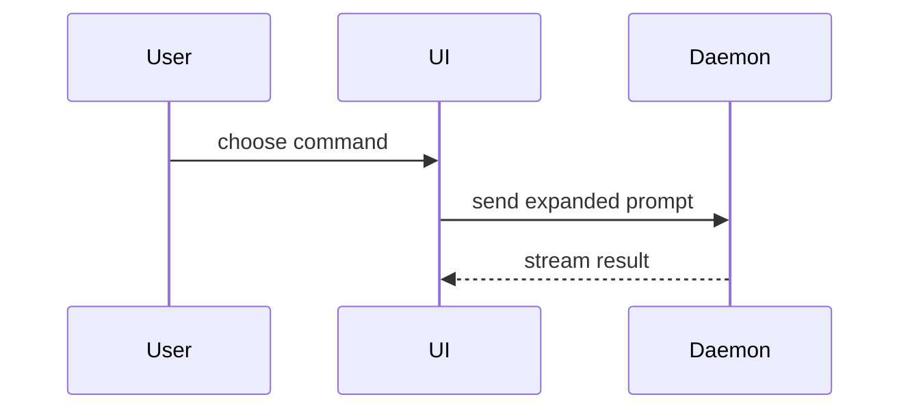

使用以下模板编写 PR 正文：

```markdown
## Summary

<diagram, diff-sketch, or tree>

## Evidence

- **Before:** <screenshot/output/failing test run>
  **After:** <screenshot/output/passing test run>

## Merge Danger

**Door:** <one-way or two-way>

<optional: description>

**Blast Radius:** <one-word description>

<optional: potential ramifications of merge>
```

## 章节（Sections）

直接进入正文，保持简短。使用 `GLOSSARY.md` 中的用户领域语言。

### Summary

选择能清楚表达关键变化的最小视图。

- 用伪代码展示逻辑或算法：

```text
on(save)
  if content is unchanged
    return cached result
  write new content
  return fresh result
```

- 用调用树展示运行时控制流：

```text
submitForm
  createSession
    persistPrompt
    launchAgent
  navigateToSession
```

- 用组件树展示 UI 结构，包含重要状态和模块边界：

```text
<SessionPage> (apps/example/src/routes/session.tsx)
  useSessionEvents()
  <SessionToolbar>
    <RunSkillButton> (packages/ui)
```

- 用浅层文件树展示文件职责或大范围重构：

```text
src/
├── commands/       # parses user actions
├── sessions/       # owns session state
└── transport/      # sends API requests
```

- 用 Mermaid 展示组件交互、控制流或数据流：



- 当重点是已有结构中的变化时，使用 `diff`，并让差异形状对应主题。

组件变更：

```diff
 <SessionPage>
   useSessionEvents()
   <SessionToolbar>
+    <RunSkillButton />
   <SessionTimeline>
+    <SkillResultCard />
```

文件布局变更：

```diff
 src/
 ├── commands/
+│   └── show-me.ts       # expands the slash command
 ├── sessions/
-└── transport.ts
+└── transport/
+    ├── client.ts
+    └── stream.ts
```

调用树或调用栈变更：

```diff
 submitForm
   createSession
     persistPrompt
+    expandSkillMention
     launchAgent
-  navigateToSession
+  navigateToSession
+    subscribeToEvents
```

状态或控制流变更：

```diff
 on(save)
-  write content
+  if content is unchanged
+    return cached result
+  write new content
+  invalidate cache
```

- 大部分内容都是新增、遗漏上下文会隐藏归属或顺序，或用户需要可复制目标时，展示完整代码块：

```ts
function expandSkill(command: string): string {
  const skillName = command.slice(1);
  return `use the ${skillName} skill`;
}
```

#### 指导（Guidance）

把每个图示放在它支持的简短文字旁边，只保留回答当前问题或比较当前选项所需的调用、文件、属性、状态和边界。

可以用一种，也可以用多种，通常不需要全部使用。根据情况选择，避免信息过载。

### Evidence

提供变更确实有效的具体证据，展示前后对照。

如果环境支持且变化可视化，截图是最佳证据。

执行证据也很有价值，例如测试结果、控制台输出；用伪代码展示同一测试修改前失败、修改后通过。

### Merge Danger

说明这是一扇单向门还是双向门（one-way or two-way door）。双向门可以返回，单向门无法返回。回退成本低的 PR 风险较低；涉及破坏性操作或难以逆转决策的变更属于单向门。

影响范围（blast radius）是这个 PR 可能波及的范围。考虑布局偏移、使用方兼容性、移动端适配等实际影响。
